# 矿港 · MineHarbor

> 一个现代、轻快、真正能干活的 Minecraft Java 版启动器。

矿港是一个基于 **Electron + React + TypeScript** 的桌面启动器。它把 Minecraft 安装、Microsoft 正版登录、模组加载器、Modrinth 内容浏览、版本内容管理和本机环境扫描收在同一个界面里。默认优先使用国内镜像，同时保留官方源作为回退，并兼容 PCL2 的版本隔离目录。

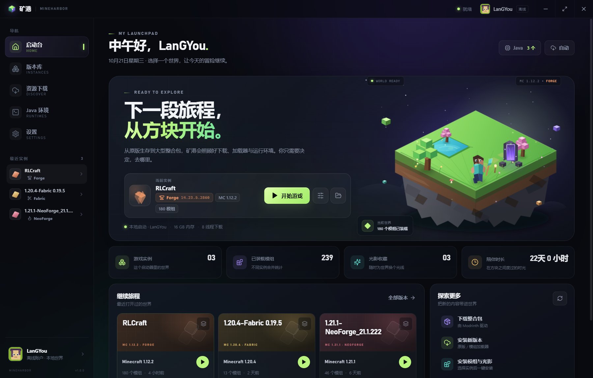

## 已实现的能力

### 游戏与加载器

- 从 Mojang 官方源或 BMCLAPI 国内镜像获取原版 Minecraft 版本清单与完整游戏文件。
- 支持正式版、快照和全部历史版本，自动下载客户端、运行库、资源索引与资源对象，并做校验。
- 支持 **Fabric / Forge / NeoForge** 加载器安装，加载器版本列表从对应元数据源获取。Forge 与 NeoForge 的安装后处理器由启动器自动执行。
- 自动根据 Minecraft 版本选择兼容的 Java，支持在实例级别覆盖 Java 和内存设置。
- 游戏内存默认取物理内存的一半；设置页支持直接输入内存上限与初始内存（MB），内存区域自带「保存设置」按钮，也可手动调整 JVM 参数、游戏参数。旧版本的 4096 MB 默认值会在升级后自动迁移到物理内存一半。
- 安装新实例时可直接手动指定该实例的内存；之后也可以在实例设置中选择「手动设置」覆盖全局内存。
- 下载源支持 **自动 / 官方 / BMCLAPI**。自动模式优先国内镜像，并在失败时回退到官方源。
- 一次安装任务包含进度反馈、阶段提示与错误信息，任务队列串行执行，界面可继续浏览。
- 安装窗口可单独指定版本目录和游戏内存，支持 PCL2 根目录、`.minecraft`、`versions` 或任意新目录。

### 账户与联机

- 支持 **Microsoft / Xbox Live 正版登录**，使用设备代码流程，不需要在应用内嵌入浏览器。
- 完整执行 Xbox Live 用户认证、XSTS 授权、Minecraft Services 登录与档案读取，可识别未购买 Java 版、儿童账户、地区限制等错误。
- 启动正版实例时向 Minecraft 注入正版档案与 `msa` 会话，可进入正版服务器。
- 登录凭据通过 Electron `safeStorage`（Windows DPAPI）加密后保存在本机，不保存 Microsoft 密码。
- 同时保留离线账户模式；正版与离线模式可以随时切换。

### 内容下载

- **整合包**：在 Modrinth 中浏览、选择版本，一键完成基础游戏、加载器、模组文件、配置覆盖的完整安装。支持导入本地 **.mrpack** 文件。
- **模组**：按当前实例的 Minecraft 版本与加载器过滤 Modrinth 项目，安装主文件并自动安装必需的依赖（可关闭）。
- **光影**：按游戏版本搜索并安装到当前实例的 shaderpacks 目录。
- 所有文件均做 SHA1 / SHA512 校验，并限制目标路径，阻止整合包路径穿越。

### 版本管理

- 创建多个独立实例，共用游戏核心与运行库，但拥有独立的 mods、shaderpacks、resourcepacks、saves、config 目录。
- 实例卡片展示加载器、Minecraft 版本、模组/光影数量、占用空间和最近启动时间。
- 实例内容管理器支持：
  - 模组、光影、资源包、存档的浏览与筛选；
  - 从本地导入文件或文件夹；
  - 启用/禁用模组（自动改名 .disabled）；
  - 删除文件、在资源管理器中定位；
  - 读取 Fabric / Quilt / Forge / NeoForge 模组元数据和图标。
- 支持打开实例目录、打开游戏根目录、重命名实例、手动输入实例 Java/内存上限、修复版本文件。
- 实时游戏控制台：启动游戏、查看 stdout/stderr、复制日志、结束进程。
- 兼容 PCL2：识别 `versions/<版本>/PCL/Setup.ini` 版本隔离标记，并将对应版本目录作为独立游戏目录导入，原有 mods、存档和设置可以直接管理。
- 外部导入的实例保留来源版本目录的名称；只有与现有实例重名时才自动追加序号。
- 外部/PCL2 实例启动时优先使用版本目录内的自建 jar，并跳过对已有第三方游戏文件的 SHA-1 强校验，避免把 PCL2 的独立版本误判为损坏。
- 侧栏「最近实例」、启动台「继续旅程」和版本库最近排序统一按最后启动时间排列；启动成功后立即刷新，不再停留在旧的实例顺序。

### 本机扫描

- 扫描 Java：
  - JAVA_HOME、PATH；
  - 常见 JDK/JRE 安装目录（Adoptium、Microsoft、Oracle、Zulu、BellSoft、Corretto、JetBrains 等）；
  - Minecraft 官方启动器自带运行时；
  - 用户手动添加的 java.exe。
  - Oracle 的 `java8path`/`javapath` 是 PATH 启动器而非第二份运行时；矿港通过 JVM 的 `java.home` 归一化并合并这些入口，避免同一个 Java 8 重复出现。
- 扫描 Minecraft：
  - 矿港自己的游戏目录；
  - 官方启动器 .minecraft 与 launcher_profiles.json 中配置的自定义目录；
  - PCL2 启动器目录、`.minecraft` 目录或 `versions` 目录；
  - 任何手动添加的游戏目录。
- 读取 versions 下的 version.json，识别原版、Fabric、Forge、NeoForge 以及它们对应的 Minecraft 版本。
- 扫描列表直接显示来源版本目录名和已导入实例名，支持复选框多选后一次性导入。

## 界面预览

| 页面 | 截图 |
| --- | --- |
| 启动台 |  |
| 版本库 | 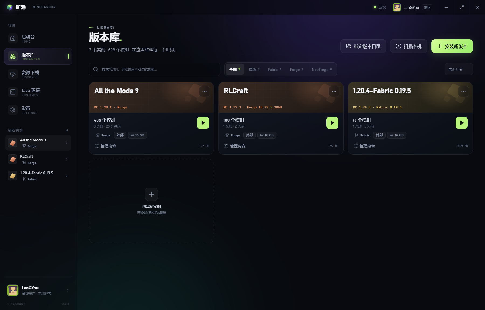 |
| 资源下载 | 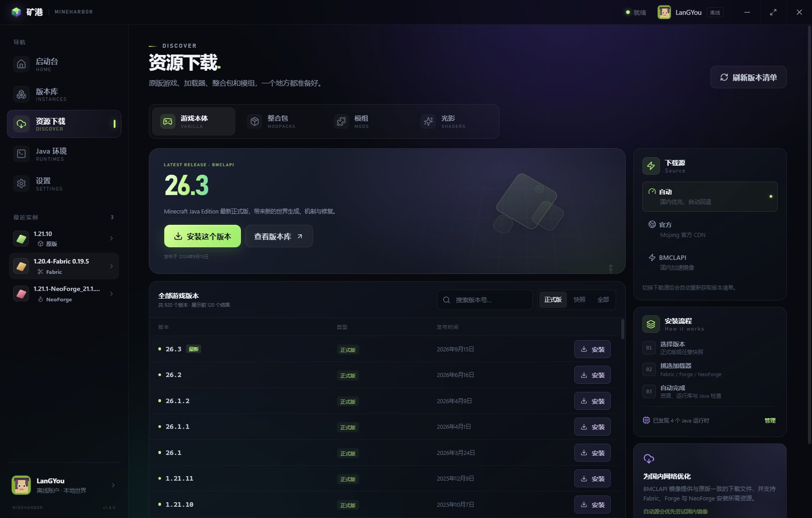 |
| Java 与本地扫描 | 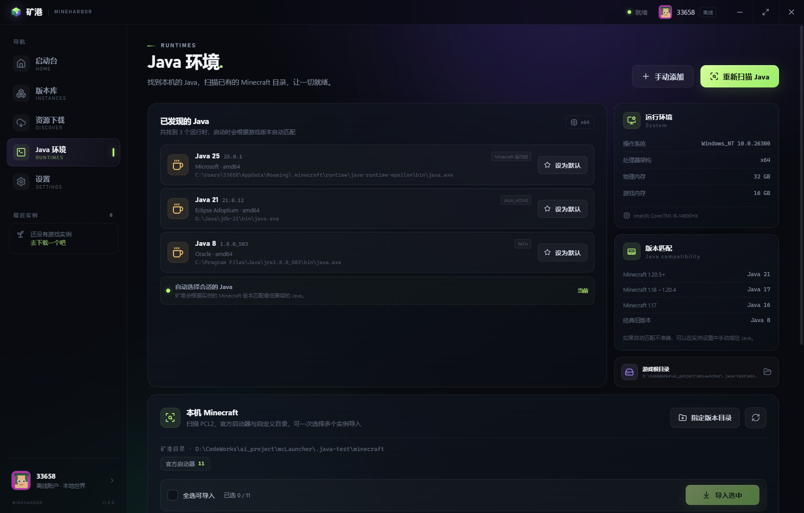 |
| 设置 | 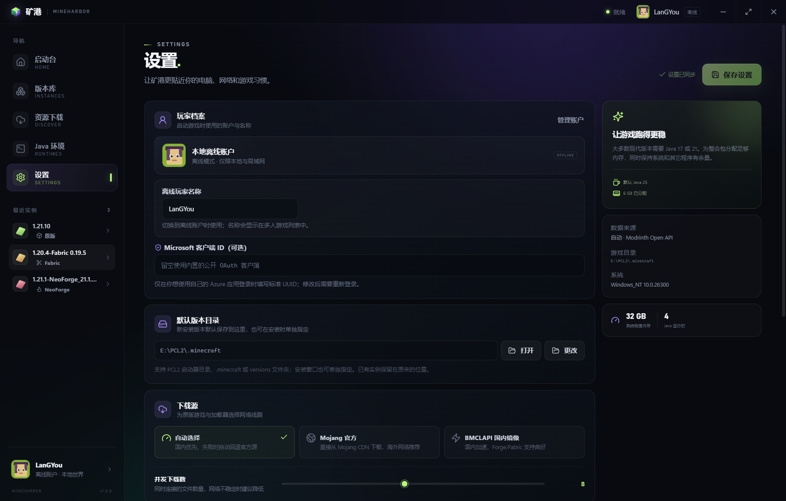 |
| 内存与启动环境 | 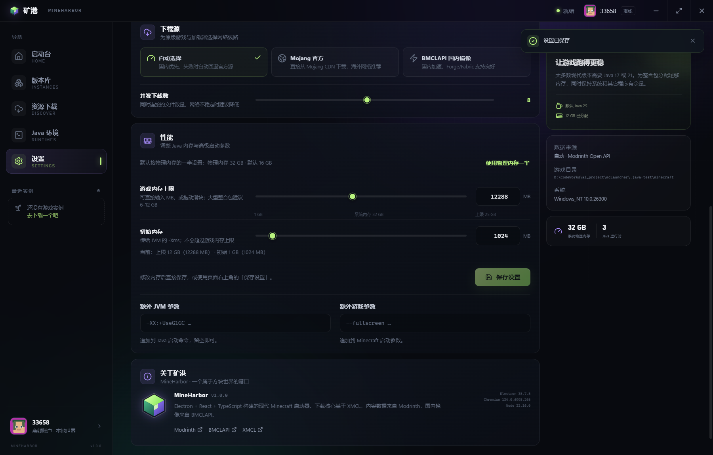 |
| 实例设置 | 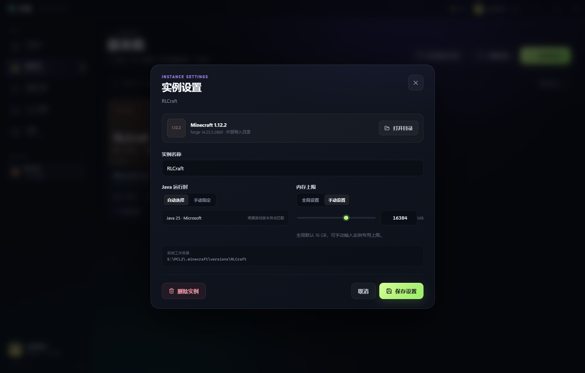 |
| 安装游戏 | 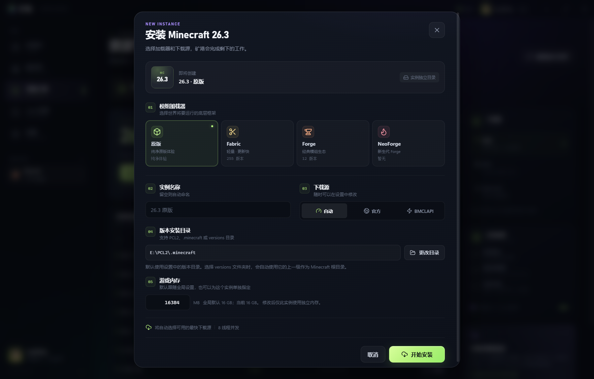 |
| 模组搜索 | 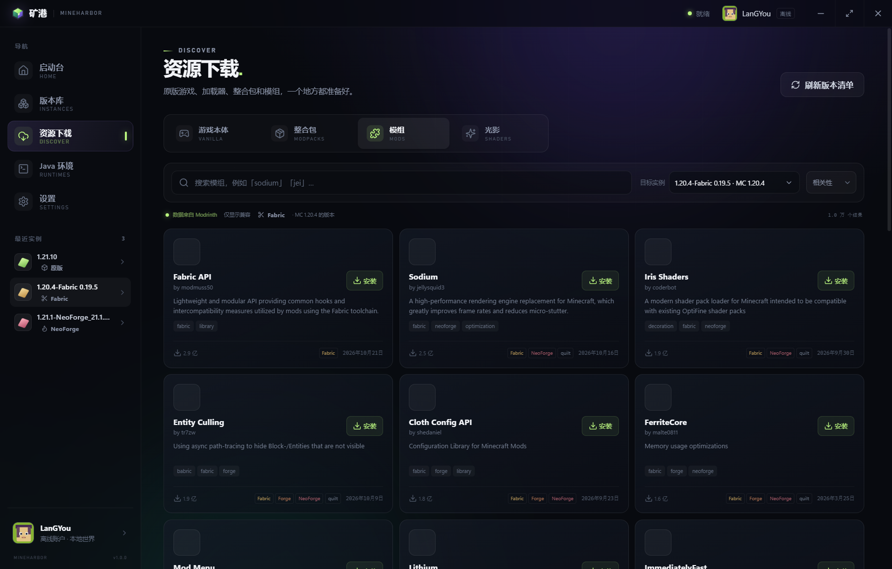 |
| 实例内容管理 | 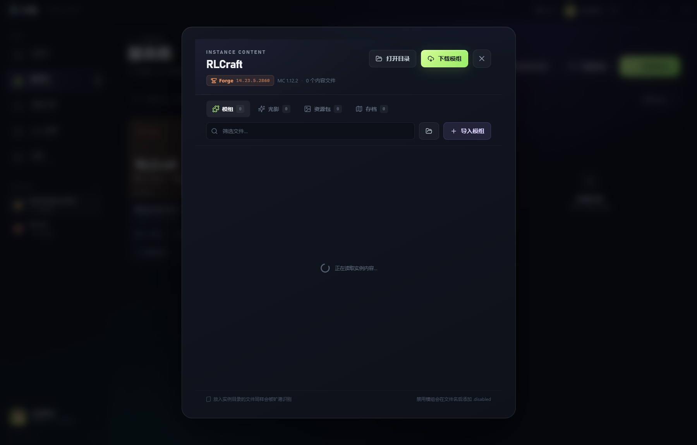 |
| 本机扫描 | 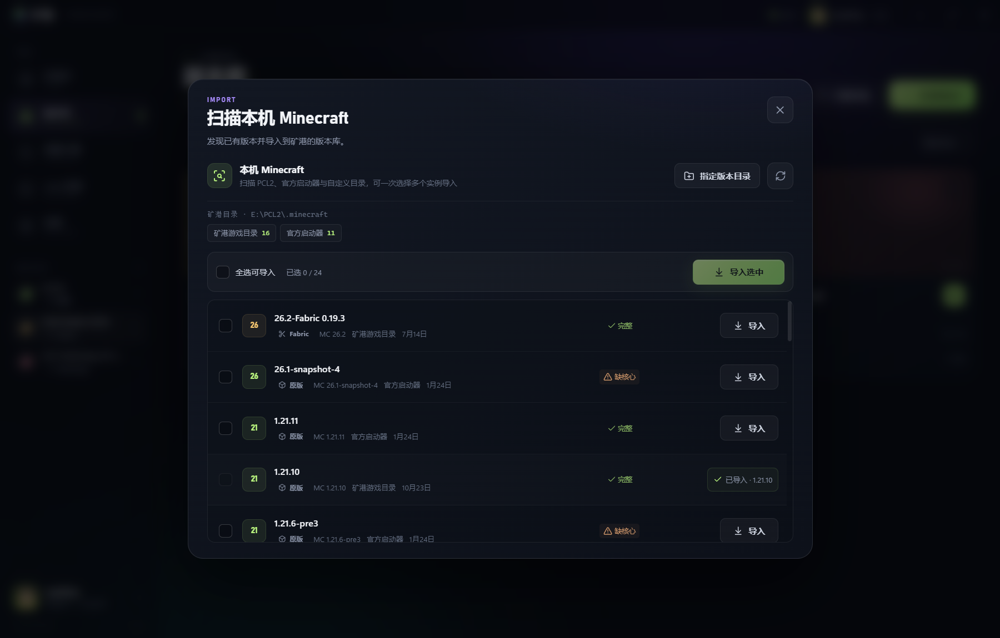 |
| 整合包选择 | 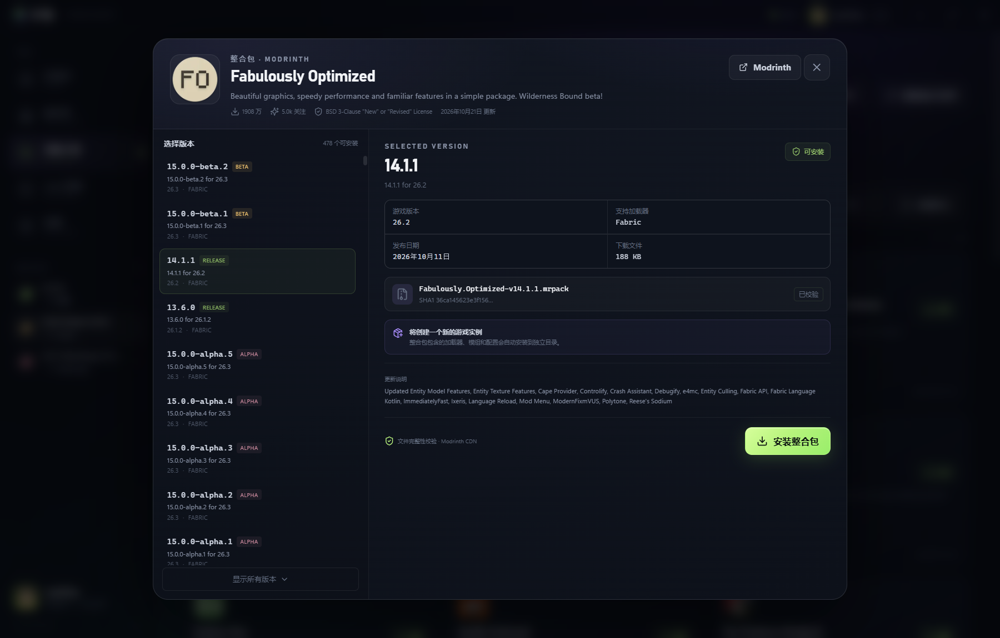 |
| 账户与正版验证 | 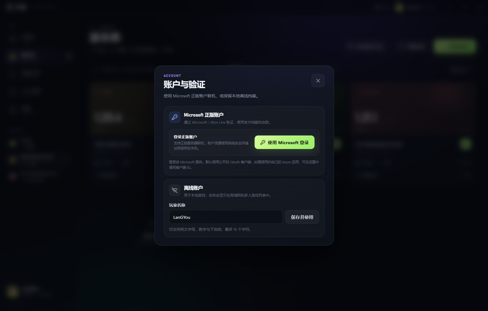 |

更多界面截图位于 docs/screenshots/。

## 运行

环境要求：

- Windows 10 / 11（主要支持平台，其他桌面平台未完整验证）
- Node.js 20 或更高版本
- 约 2 GB 可用磁盘空间（视安装的游戏与内容而定）

### 直接启动

双击 **start.bat**。首次运行会自动安装依赖并构建，然后打开应用。

也可手动执行：

    npm install
    npm run build
    npx electron .

### 开发模式

    npm run dev

### 类型检查与测试

    npm run typecheck
    npm test

测试覆盖镜像 URL 重写、Java 版本解析、实例内容管理、路径安全、本地版本扫描、PCL2 目录识别、Microsoft 登录与刷新链路、错误映射与加载器元数据，共 28 个断言。

### 打包安装包

    npm run build:win

同时生成 NSIS 安装包与便携版，输出位于 release/ 目录：

- `MineHarbor-Setup-1.0.3.exe`：可交互安装包，可自选安装目录，创建桌面与开始菜单快捷方式；
- `MineHarbor-1.0.3-portable.exe`：便携版，双击运行。

只生成安装包可以执行 `npm run build:installer`，或双击 **build-installer.bat**。安装包默认按当前用户安装，不需要管理员权限；卸载时保留 `.minecraft` 和 `MineHarborData` 数据目录。

安装到已有安装目录时会覆盖旧版本的启动器文件并继续使用原游戏目录、实例、账户会话与配置，不需要先手动卸载。

## 数据目录

安装版与便携版采用与 PCL2 类似的“启动器文件 + 游戏目录 + 启动器数据目录”布局：

    MineHarbor/
      MineHarbor.exe
      .minecraft/               # 默认游戏根目录
        versions/               # 游戏核心与加载器版本
        libraries/              # 共享运行库
        assets/                 # 共享资源
        instances/<id>/         # 矿港创建的独立实例
      MineHarborData/           # 启动器自己的数据目录
        config.json             # 配置与实例登记
        account-session.bin     # safeStorage 加密的 Microsoft 会话
        java-cache.json         # Java 扫描缓存
        cache/                  # 整合包与临时文件缓存
      resources/                # Electron 运行时（安装包自带）

- **安装版**：安装器会在所选安装目录中创建 .minecraft、MineHarborData 与游戏子目录。数据随安装目录保存；卸载器会保留 .minecraft 和 MineHarborData。
- **便携版**：.minecraft 与 MineHarborData 会创建在便携版 EXE 所在目录，移动文件夹即可整体迁移。
- **源码开发模式**：为了避免污染项目目录，数据仍保存在 %APPDATA%\MineHarbor，默认游戏目录为其中的 minecraft。

游戏根目录可以在「设置」中查看、打开和修改，也可以在每次安装时单独指定。程序会识别 PCL2 根目录、.minecraft 目录与 versions 目录，并自动规范化到真正的游戏根目录。

导入 PCL2 的版本隔离实例时，游戏目录保持为 versions/<版本名>，原有 mods、光影、存档与配置不会被复制或移动。

## 下载源说明

- **自动**：优先 BMCLAPI，失败时回退到 Mojang / 官方 Maven。
- **官方**：优先 Mojang 官方 CDN 与官方 Maven；接口不可用时仍保留回退路径。
- **BMCLAPI**：使用 bmclapi2.bangbang93.com 镜像原版文件、资源、运行库与加载器安装器。

BMCLAPI 的 Maven 索引有时会落后，因此 Forge 版本列表使用 BMCLAPI 的版本接口而不是旧 metadata；NeoForge 版本从 neoforged 的 Maven metadata 获取。

## 技术架构

    src/
      main/                    # Electron 主进程
        services/
          installer.ts         # 原版 + Fabric/Forge/NeoForge 安装
          auth.ts              # Microsoft / Xbox 正版认证与加密会话
          game.ts              # 实例安装、启动、正版会话注入与进程控制
          contentInstaller.ts  # 模组、光影、整合包
          content.ts           # 实例内容扫描与管理
          minecraft.ts         # 本地版本扫描与导入
          java.ts              # Java 扫描与版本选择
          catalog.ts           # 版本清单、加载器列表
          sources.ts           # 镜像 URL 重写与源策略
          modrinth.ts          # Modrinth API 客户端
          jobs.ts / config.ts  # 任务队列与配置持久化
      preload/                 # contextBridge 安全 API
      renderer/                # React 19 + Vite 界面
      shared/                  # 主进程与渲染进程共享类型

- Electron 主进程负责所有文件系统、下载、进程启动与外部 API 访问。
- 渲染进程启用上下文隔离，不直接访问 Node API；仅通过白名单 IPC 调用主进程。
- 游戏安装与启动基于 XMCL（@xmcl/installer、@xmcl/core）。下载源替换、镜像选择、界面与实例管理由矿港实现。
- 内容数据来自 Modrinth 开放 API；图标直接使用 Modrinth CDN。
- 正版登录使用 Microsoft 设备代码 OAuth、Xbox Live 与 Minecraft Services；access token / refresh token 经 Electron safeStorage 加密后写入 MineHarborData，不保存 Microsoft 密码。
- 默认使用社区公开的 OAuth 客户端 ID `c36a9fb6-4f2a-41ff-90bd-ae7cc92031eb`；如果计划公开分发，建议在设置中替换为你自己注册的 Azure 应用客户端 ID。

## 已知限制

- 正版登录依赖 Microsoft / Xbox Live 的网络可达性；无法访问这些服务时仍可使用离线账户。
- 默认 OAuth 客户端是社区公开客户端，登录同意页可能显示对应开源启动器名称；公开分发前请配置自己的 Azure 客户端 ID。
- 本地整合包支持 Modrinth 的 .mrpack；暂不支持 CurseForge 的 manifest.zip。
- Quilt 加载器暂不支持；整合包若只声明 Quilt 会给出明确错误。
- 首次安装 Forge / NeoForge 需要 Java，且为了执行安装器处理器可能比较耗时。NeoForge 使用官方安装器的离线模式：矿港会先从所选镜像补齐安装器所需的全部依赖，再执行补丁流程，以避免安装器访问国内不稳定的官方 Maven。
- 自动扫描不会遍历整个磁盘，只检查常见目录和已保存的自定义目录；其他位置请手动添加。
- 首次安装原版时会下载完整的资源文件（约数百 MB，视版本而定）。成功安装后会在游戏目录记录完成标记，之后为同一版本安装加载器不会重复校验整套资源。
- 外部导入的实例与原始 .minecraft 共享内容目录（PCL2 版本隔离目录则保留其版本目录）。这是为了避免复制用户已有的巨大资源目录。
- 安装版的数据位于安装目录内；手动删除整个安装目录也会删除游戏数据，卸载器则会保留 `.minecraft` 和 `MineHarborData`。

## 第三方服务

- Minecraft 元数据与文件：Mojang
- 国内镜像：BMCLAPI
- 安装与启动核心：XMCL
- 正版认证：Microsoft Identity Platform、Xbox Live、Minecraft Services
- 目录兼容参考：PCL2（仅参考其便携目录与版本隔离布局，本项目与 PCL2 无隶属关系）
- 内容目录与下载：Modrinth
- 界面图标：Lucide

本项目仅用于学习和个人使用。Minecraft 是 Mojang Studios 的商标，与 Mojang / Microsoft 无隶属关系。